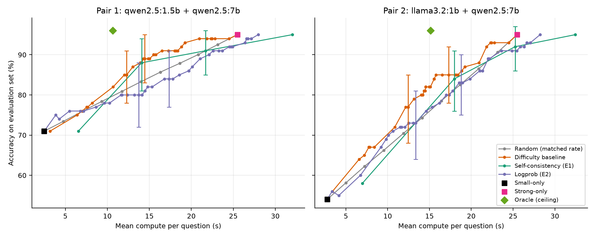

# LLM Routing — Cheap-First Escalation Between Small and Strong Models

Not every question needs the biggest model. This project tests **when a small, cheap language model is good enough and when a question should be escalated to a stronger, slower one**, and measures how much compute time can be saved without losing much accuracy.

Everything runs **locally with [Ollama](https://ollama.com)**. No paid API is used.

---

## The idea in plain words

1. A question arrives.
2. A **small model** looks at it first.
3. An **escalation signal** decides: "Can I trust the small model's answer?"
4. If yes, keep the answer. If no, **escalate** to the **strong model**.

The goal is accuracy close to "always use the strong model" while spending much less compute.

```
Question --> Small model --> Escalation signal --> Trust it? --> Yes --> Final answer
                                                       |
                                                       +--> No --> Strong model --> Final answer
```

## Models and data

| Role | Model |
|------|-------|
| Small, pair 1 | `qwen2.5:1.5b` |
| Small, pair 2 (different family) | `llama3.2:1b` |
| Medium (three-tier only) | `qwen2.5:3b` |
| Strong | `qwen2.5:7b` |

- **Dataset:** [GSM8K](https://huggingface.co/datasets/openai/gsm8k) math word problems.
- **Splits:** 25 pilot and 50 calibration questions (from train, no overlap), 100 evaluation questions (from test).
- **Calibration** is where all thresholds are chosen. The evaluation split is never used to tune anything.
- All settings live in one file: `configs/experiment.yaml`.

## Strategies compared

| Code | Strategy | How it decides |
|------|----------|----------------|
| A | Small-only | Never escalate |
| B | Strong-only | Always escalate |
| C | Random | Escalate with a fixed probability (averaged over 200 seeds) |
| D | Question difficulty | Escalate if the question looks hard (word, number and sentence counts) |
| E1 | Self-consistency | Ask the small model 3 times; escalate if the answers disagree |
| E2 | Token confidence | Escalate if the small model's token probabilities are low |
| R | RouteLLM (BERT router) | Extra baseline using the open-source [RouteLLM](https://github.com/lm-sys/RouteLLM) router |
| P / TS | Capability profile / two-stage | Route by difficulty bucket, then check with E1 |
| 3T | Three-tier cascade | small -> medium -> strong, checking with E1 at each step |
| Ref | Oracle | Uses the true answers. A ceiling only, never deployable |

Each signal is tested at two operating points, both set on calibration data:
- **budget:** escalate roughly 30% of questions
- **recall:** catch about 70% of the small model's mistakes

**Cost** means recorded compute seconds per question on one laptop (small-model time plus strong-model time, plus the signal's own overhead, for example E1's three extra samples). Two cost conventions are run: *primary* (random and difficulty skip the small call when they escalate) and *strict* (every question pays for the small call first). Results for both are in `results/`.

## Main results (100 GSM8K test questions)

| Pair | Strategy | Accuracy | Escalated | Cost (s/question) |
|------|----------|----------|-----------|-------------------|
| 1 (qwen 1.5B) | A small-only | 71% | 0% | 2.5 |
| 1 | B strong-only | 95% | 100% | 25.5 |
| 1 | E1 self-consistency (budget) | **88%** | 24% | 14.1 |
| 1 | D difficulty, same escalation rate | 80% | 24% | 9.7 |
| 1 | C random, same escalation rate | 77% | 24% | 8.0 |
| 1 | R RouteLLM, same escalation rate | 79% | 24% | 8.9 |
| 2 (llama 1B) | A small-only | 54% | 0% | 2.8 |
| 2 | B strong-only | 95% | 100% | 25.5 |
| 2 | E1 self-consistency (budget) | **84%** | 36% | 18.0 |
| 2 | D difficulty, same escalation rate | 78% | 36% | 12.7 |
| 2 | C random, same escalation rate | 69% | 36% | 10.9 |
| 2 | R RouteLLM, same escalation rate | 73% | 36% | 11.1 |

Figures are in `figures/` (quality vs cost, accuracy vs escalation rate, latency, transfer to the second model pair).



### What the results say

- **Self-consistency (E1) was the best signal.** It beat random escalation clearly in both pairs. Against the cheap difficulty rule the gap was smaller and only borderline significant at the budget point.
- **Pair 1, E1 at the budget point** reached 88% accuracy at about 45% less compute time than strong-only (14.1 s vs 25.5 s per question), but stayed below strong-only accuracy (95%).
- **Token confidence (E2) was weak.** It did not reliably beat random or the difficulty rule.
- **RouteLLM's BERT router was close to random on this task.** Its ability to spot the small model's mistakes was low (AUC 0.53 for pair 1 and 0.60 for pair 2, where 0.5 means no signal), compared with about 0.73 to 0.76 for E1 and for the difficulty score. This is a result on one task with one pre-trained router, not a general claim about RouteLLM.
- **The capability-profile router** sent every question to the strong model at the 85% quality target, because no difficulty bucket had enough small-model accuracy. It matched strong-only exactly.
- **Three-tier cascade:** the setting `t1=0.833, t2=0.833` reached 92% at 22.0 s per question, against 95% at 25.5 s for strong-only.

## Limitations

- Only **100 evaluation questions**, so confidence intervals are wide. Most gaps between the smarter signals are not statistically significant.
- One task type (grade-school math) and one strong model.
- **`qwen2.5:3b` alone scored 91% at 5.4 s per question**, cheaper than most routed setups here. For this task and these models, simply using the 3B model was hard to beat, so the benefit of routing depends on which models are available.
- Cost is measured compute time on one laptop, not money. Real API pricing would change the trade-offs.
- Thresholds were calibrated on only 50 questions.

## Project structure

```
LLM-Routing/
├── configs/experiment.yaml     # all settings (models, sizes, thresholds)
├── data/                       # pilot / calibration / evaluation splits
├── scripts/                    # entry points (see "How to run")
├── src/
│   ├── data/                   # GSM8K loading and splitting
│   ├── models/                 # Ollama adapter (greedy, sampling, logprobs)
│   ├── evaluation/             # final-answer extraction and correctness
│   ├── routing/                # strategies, tiered router, RouteLLM strategy
│   ├── experiments/            # collection, replay, plots
│   └── metrics/                # accuracy, bootstrap CIs, paired tests
├── tests/                      # pytest unit tests
├── results/                    # CSV summaries, paired tests, raw model outputs
└── figures/                    # result plots
```

**Collect once, replay many times:** model outputs (greedy answer, 3 sampled answers, token log-probabilities, timings) are saved first. Every strategy is then replayed on the *same saved outputs* with no new model calls, so comparisons are fair and fast.

## Setup

**Needs:** Python 3.11, [Ollama](https://ollama.com), about 16 GB RAM (a 4 GB GPU helps).

```bash
git clone https://github.com/Bunty5600/LLM-Routing.git
cd LLM-Routing
pip install -r requirements.txt

ollama pull qwen2.5:1.5b
ollama pull llama3.2:1b
ollama pull qwen2.5:3b
ollama pull qwen2.5:7b

python scripts/check_ollama.py qwen2.5:7b
```

## How to run

```bash
# 1. Create the splits
python scripts/prepare_data.py

# 2. (Optional) pilot run to choose models
python scripts/run_pilot.py

# 3. Collect model outputs (small models also store samples and logprobs)
python scripts/run_collect.py --model qwen2.5:1.5b --split calibration --role small
python scripts/run_collect.py --model qwen2.5:1.5b --split evaluation  --role small
python scripts/run_collect.py --model llama3.2:1b  --split calibration --role small
python scripts/run_collect.py --model llama3.2:1b  --split evaluation  --role small
python scripts/run_collect.py --model qwen2.5:7b   --split calibration --role strong
python scripts/run_collect.py --model qwen2.5:7b   --split evaluation  --role strong
python scripts/run_collect.py --model qwen2.5:3b   --split calibration --role small
python scripts/run_collect.py --model qwen2.5:3b   --split evaluation  --role small

# 4. Replay all strategies and make figures
python scripts/run_replay.py
python scripts/run_plots.py
python scripts/run_tiered_replay.py

# 5. RouteLLM baseline (scoring needs a separate environment with routellm installed)
python scripts/score_routellm.py          # run inside the routellm environment
python scripts/run_routellm_replay.py     # run in your main environment
```

Collection resumes where it stopped if interrupted. Run the tests with `pytest`.

## Acknowledgements

- [RouteLLM](https://github.com/lm-sys/RouteLLM) (LMSYS) for the baseline router
- [Ollama](https://ollama.com) for local model serving
- [GSM8K](https://huggingface.co/datasets/openai/gsm8k) dataset

## Author

**Bunty** — [GitHub](https://github.com/Bunty5600) · buntybhainsa0@gmail.com
